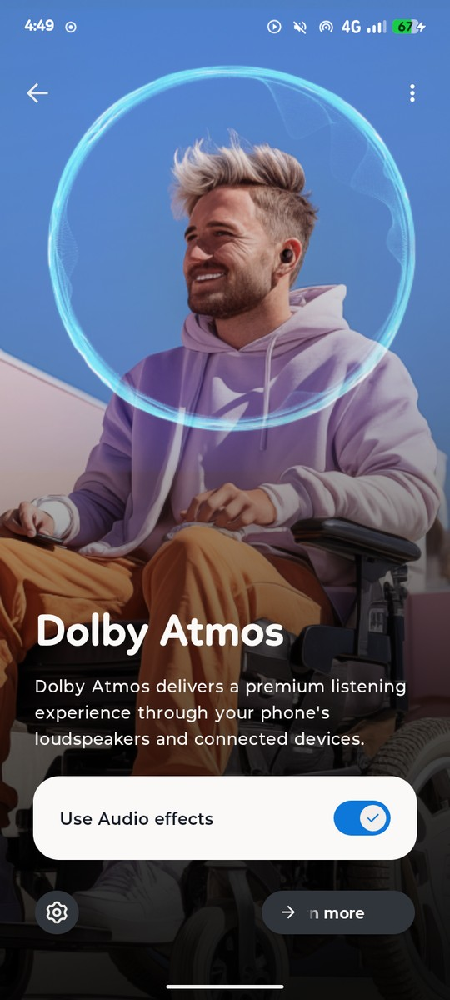
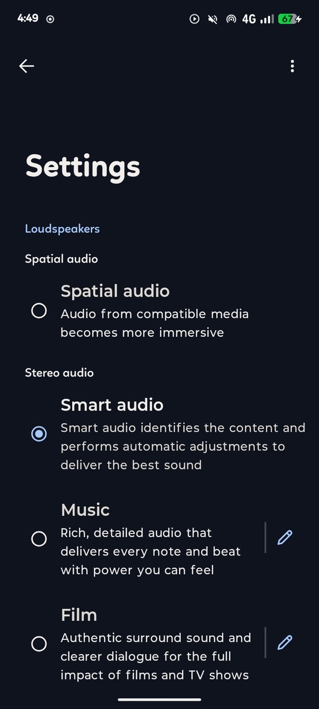
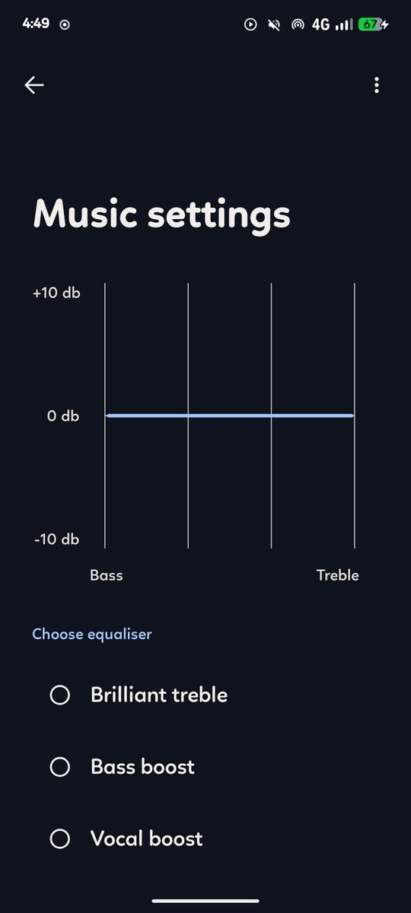

# Motorola Dolby for moto g34 5G

Motorola's **stock Dolby Atmos stack**, ported to run on AOSP-based ROMs on the
moto g34 5G (`fogos`, sm6375).

<p align="center">
  
  
  
</p>

---


## Requirements

- moto g34 5G (`fogos`) or another sm6375 device with a matching Dolby tuning file
- An AOSP-based ROM (tested on Axion AOSP, Android 16 / SDK 36)
- The device tree must inherit `hardware/dolby/dolby.mk` — already the case in
  `android_device_motorola_sm6375-common`

## Installation

Clone into your tree at the path the device tree expects:

```bash
git clone https://github.com/tiraq-official/hardware_dolby_motorola.git hardware/dolby
```

That path matters. `dolby.mk` sets `DOLBY_PATH := hardware/dolby`, and
`android_device_motorola_sm6375-common/common.mk` does:

```make
$(call inherit-product, hardware/dolby/dolby.mk)
```

No other include or manifest change is needed — `media/media_codecs_c2.xml` already
picks up `media_codecs_dolby_audio.xml`.

## Credits

- **Motorola** and **Dolby Laboratories** for the stack and the tuning.


## Codec2 Store & Decoders (DD+ / E-AC-3 / AC-4)

The Motorola Dolby Codec2 component store registers as instance `default9` (`android.hardware.media.c2@1.0::IComponentStore/default9`), providing `c2.dolby.eac3.decoder` and `c2.dolby.ac4.decoder`. Both the VINTF manifest and the init service (`class hal`) are configured and enabled.

